I have a problem: I always forget the beta when I climb. For those unfamiliar with climbing terms, the beta is the sequence of moves you use to get up a climb, which hand goes where, which foot goes where, and so on.

Some people amaze me at how they can see a sequence once and then replicate it exactly, move after move. I can't do that. Even on climbs that I've tried dozens of times, I always end up wondering, was it left hand first or right hand first? Did I use that little black smear or that grey patch??

Even worse is when I leave a project unsent at the end of the season and I get back on it a year later. Man, that's like I've never been on it before, may as well reset the onsight counter.

## The logbook essays

Anyway, my solution to this has always been the UKC logbook. I love writing essays on my logbook, describing every single move, details, holds, important sequences etc, ending up with pages and pages worth of data. Sometimes I even go through every single move in a video, while down climbing, and then transcribe it in reverse onto my logbook.

<figure class="shot wide">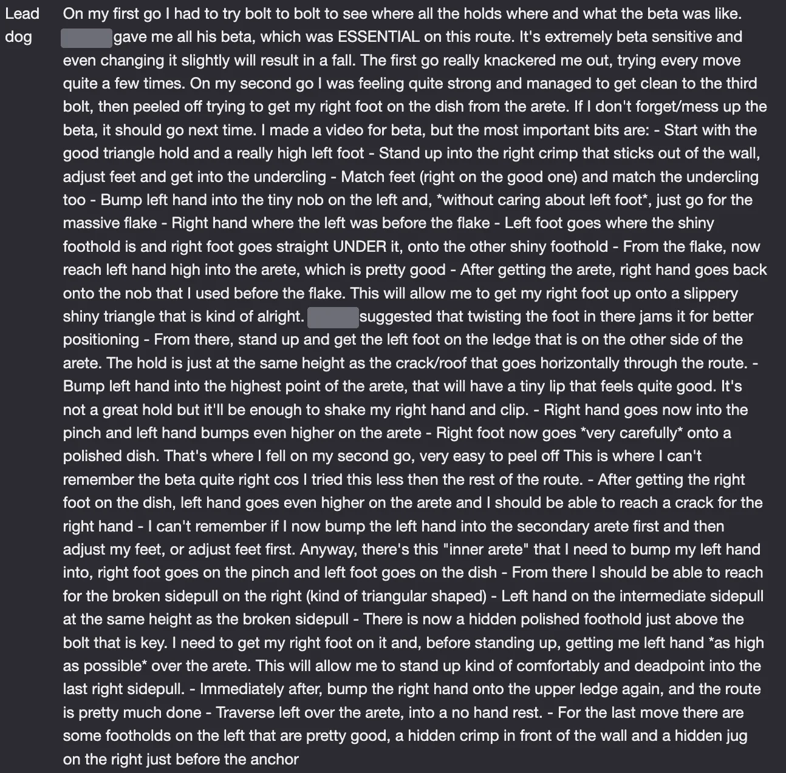<figcaption>One of my logbook essays, for a single day on a route</figcaption></figure>

The problem is, a year goes by, I get back to the crag at the same project, I open the logbook and I'm met with this book worth of text that I can't be bothered to read. I just want to climb. And even when I do, most of it doesn't make sense anymore because I can't remember what the holds look like, and something like "broken block of cheese pinch" doesn't mean anything anymore. I'm sure it was extremely obvious at the time.

Videos of someone climbing can be a good way to remind yourself of a beta, but they're not enough to capture the details of every single hold, what's important and everything else. So I thought there must be a way around this.

## Beta maps, but on a canvas

I know people use beta maps to solve this sort of issue. A piece of paper where you draw all the holds, how they connect, all the notes and everything. But the moment I tried that I felt like it would be so much better if I could move things around, add photos, reshape things, kind of like a digital canvas.

So I thought, what if I made an app that allows that? I always wanted to try making an app, so this was a great place to try it. Something solving a problem I actually have. Sure, it would be super niche. An app for climbers, who like projecting stuff, who like technology, who have Android, who wouldn't mind using their phone while climbing... I knew there was at least me in that Venn diagram, and that was enough.

## The first version

The first attempt at the app was very basic, but I already had in mind this idea of one canvas and two "modes", the holds and the beta. Holds to create your route, beta to create your climb.

<figure class="shot">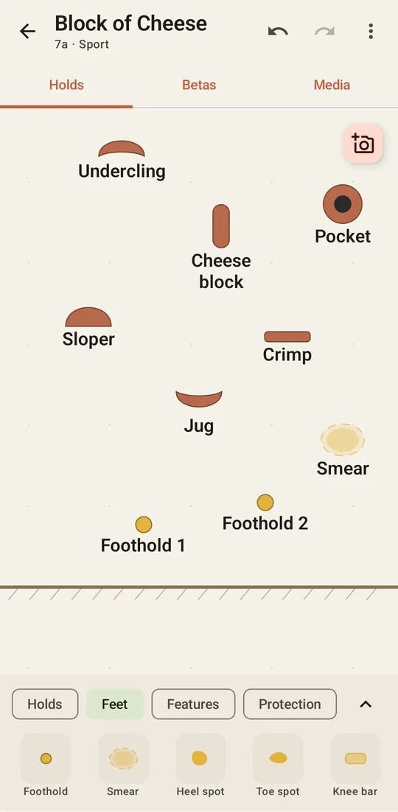<figcaption>The Holds tab of the first version</figcaption></figure>
<figure class="shot">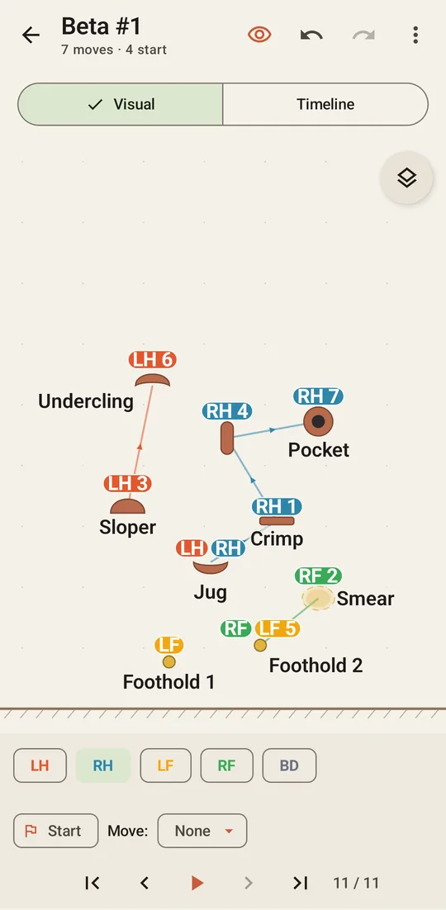<figcaption>The same route in the beta editor</figcaption></figure>

In the Holds tab you picked a hold from the drawer at the bottom and then tapped on the wall to place it, move it and rotate it. You could also give a hold a nickname, add photos and record voice notes, so finally my "broken block of cheese pinch" could have a picture next to it!

In the beta tab you picked a limb and tapped the holds in the order you used them. Every move became a coloured pill and arrows joined the moves of each limb.

<figure class="shot">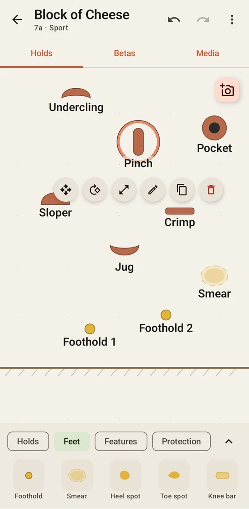<figcaption>Six buttons for the selected hold</figcaption></figure>
<figure class="shot">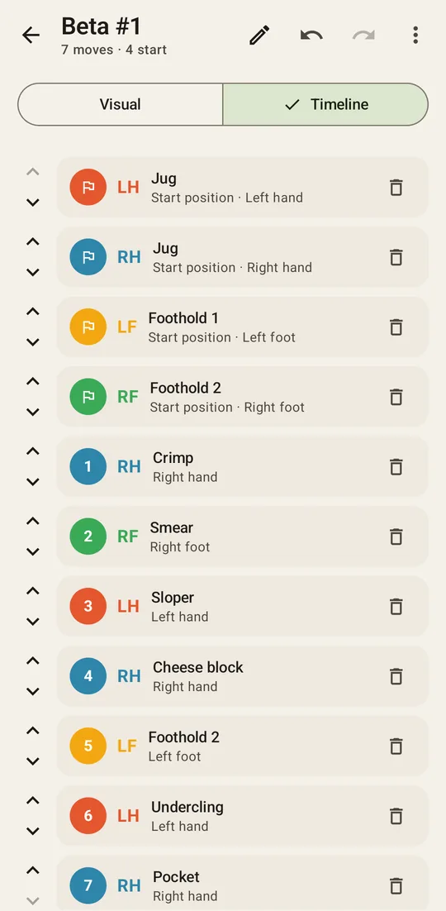<figcaption>The Timeline, same beta but as a list</figcaption></figure>

It wasn't pretty. But it worked! Looking at it now, pretty much everything on these screens has changed since then.

## Build, try, repeat

Something that I didn't expect is how much I'd enjoy the process. I draft a functionality, then I go to the gym or to the crag, try the app myself and figure out that either it doesn't work at all, or what I need to do to improve things. Then I go back home, fix it, and back to the wall again. Repeat.

It's a very different kind of testing compared to sitting at a desk. A button that looks perfectly fine at home is suddenly tiny when you're standing under a route with chalky fingers. And a screen that makes total sense when you're building it is just noise when all you want to know is which hand goes first.

Feedback from friends has also been extremely important. I know how the app is *supposed* to work, which makes me the worst person to judge if it's obvious or not. Watching someone else use it for the first time and get stuck exactly where I'd never think to look was quite humbling, but super useful.

## Too many modes

A few weeks later the app had grown a lot, and with it came a problem: it was a mess. When you opened a climb you got multiple tabs, each of those had its own menus, each with its own modes.

<figure class="shot">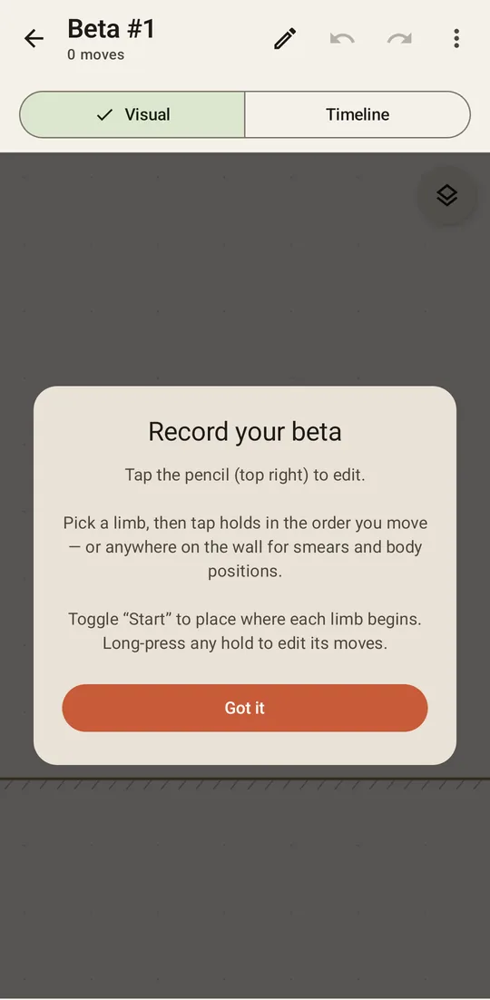<figcaption>The first thing a new beta said</figcaption></figure>

I designed this and I got really confused myself! And if the person who designed it gets confused, I can't imagine everyone else. So I started cutting, simplifying and removing everything that was unnecessary. But one thing was still bothering me a lot: I just couldn't quite visualise the moves *of my own project* using those movement pills and arrows. I kept trying to convince myself it was my own problem, that surely, someone out there might find it useful looking at those pills. But that wasn't enough.

<figure class="shot">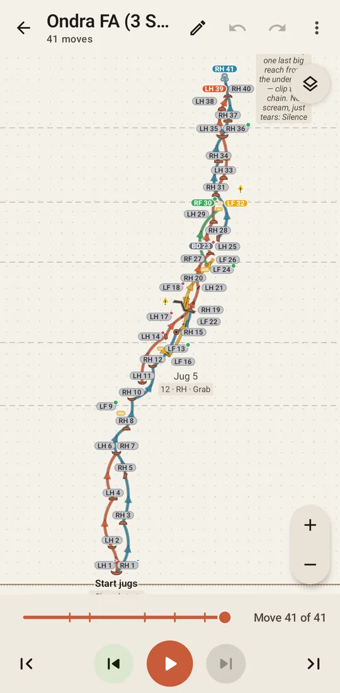<figcaption>Every move of Silence at once</figcaption></figure>

## From arrows to a climber

The arrows in the first version were too hard to read. With four limbs moving, a beta of 20 moves turned into an absolute mess. I tried a "focus" view that only showed the last couple of moves of each limb, then curved arrows that dodged the holds... but I still couldn't follow the beta.

Then a friend suggested something that could help: drawing the actual climber on the wall. And so I tried with a little stick figure having its hands and feet on the holds of the current move. At first it was just an extra viewing option alongside the arrows. But it was immediately obvious which one was better.

<figure class="shot">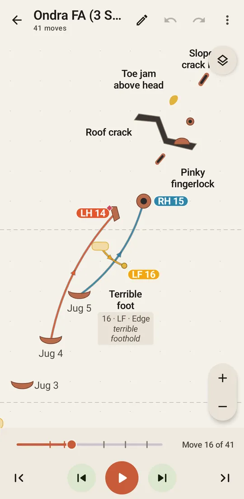<figcaption>Move 16 of Silence as arrows</figcaption></figure>
<figure class="shot">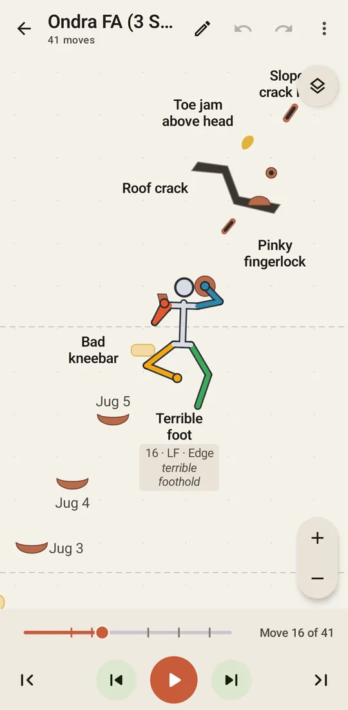<figcaption>The very first climber!</figcaption></figure>

You don't need to decode anything, you see a person on the wall and you see where the next hand goes. Soon after that, the climber figure became the main and only viewing mode within the app.

Getting that little stick man to look like a real climber and not like a mess turned out to be the biggest piece of work of the whole app. But that's probably a story for another post.

## The app that asked too many questions

After a few weeks I started noticing a pattern, the app kept asking me things it didn't really need to know.

For example, the first move of every new beta came with a question: "Record the starting position?". The starting position was a whole concept, with its own flag, its own banner and its own reset button, just to say that these moves happen at the same time. And it interrupted the very first move you tried to add! So it had to go. Now any moves can happen at the same time, including the first ones, and the first group simply *is* the starting position. No need to ask anyone.

Then there was the height of the climb. For a while the app wanted to know how tall your route was (10 m, 15 m, 20 m, 30 m...) so that it could draw the holds with the right size. That's useful for the app, sure, but think about it from the point of view of a climber: why would you care? So I dropped it.

<figure class="shot">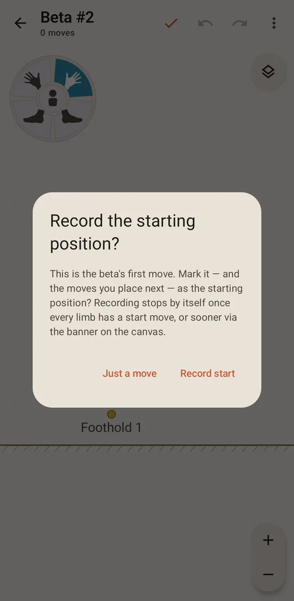<figcaption>The question that interrupted every first move</figcaption></figure>
<figure class="shot">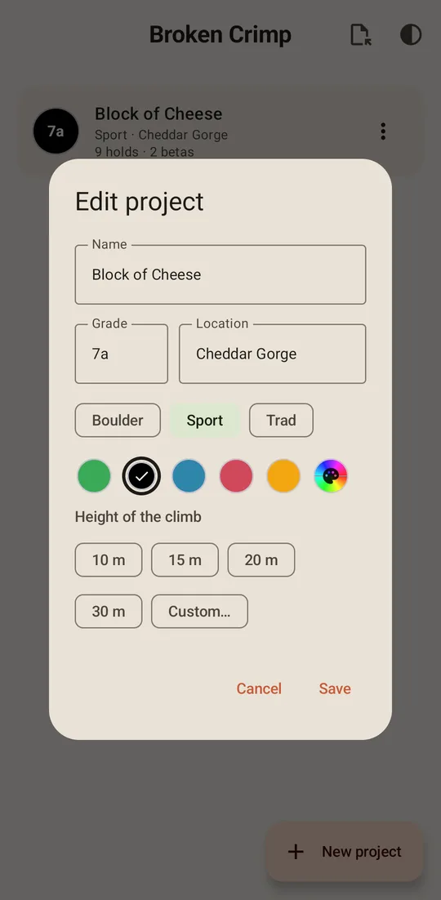<figcaption>How tall is your climb? And what colour?</figcaption></figure>

## Words matter

One of the difficult things I had to choose in the app was its own vocabulary. The button to create a new beta used to say "Record a beta", which seemed perfect at the time. Until I realised that "record" makes people think of filming a video, which the app doesn't do.

Same story with the limbs. When a hand or a foot stretches too far, the app takes it off the wall (in real life you would've let go of that hold ages ago) and you can stop that from happening for a specific limb. For weeks this option was called "tracking", and it had a padlock on it. Tracking sounds like following a climber in a video, and a padlock... ?? It's called a pin now, with a little push pin next to the limb, because that's what it does, it pins the limb to its hold.

## Where it is now

Since Broken Crimp went on the Play Store, a lot has changed. The app now runs in the browser too, so iPhone users can open it as well. You can start a climb from a photo of the wall and put the moves straight on it, adding holds only if you want to. You can share a beta with a friend, or turn it into a PDF or a video. And it comes with a few famous climbs to play with, like Silence, Burden of Dreams and DNA.

<figure class="shot">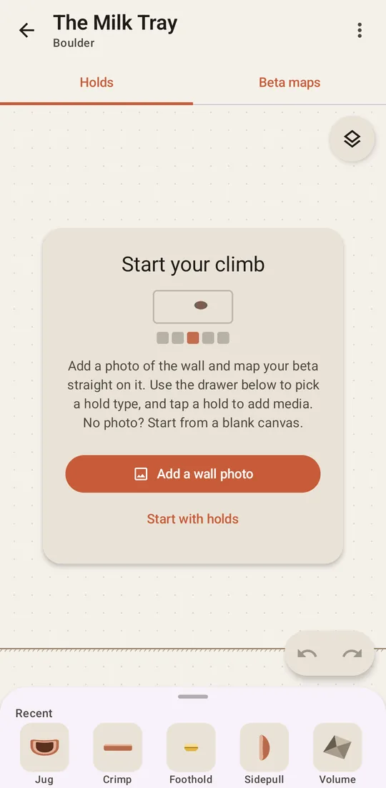<figcaption>A new climb starts from a photo</figcaption></figure>
<figure class="shot">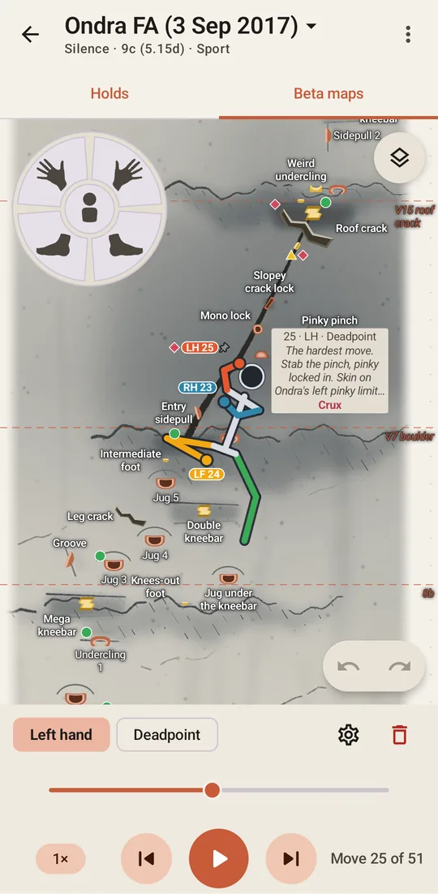<figcaption>Silence, 9c, move 25 of 51</figcaption></figure>

One of my favourite new functions is comparing two betas: two climbers on the same wall, one blue and one orange, moving together, so that you can see exactly where your beta and your friend's go different ways.

<figure class="shot">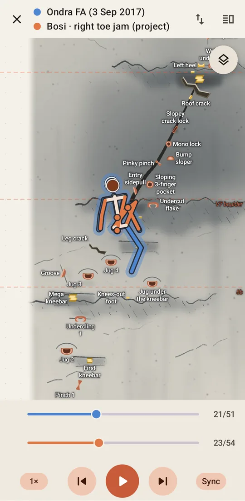<figcaption>Two betas of Silence, side by side</figcaption></figure>

And this is it. It's still super niche, an app for climbers who like projecting stuff, who like technology and who don't mind getting their phone out at the crag. I knew there was at least me in that niche, and there still is! If you're in it too, give it a go, and if something doesn't make sense please let me know, that's pretty much how this whole app got made.

You can try it yourself: get it on the [Play Store](https://play.google.com/store/apps/details?id=com.brokencrimp.app), or open it straight [in your browser](/app/), with nothing to install.
